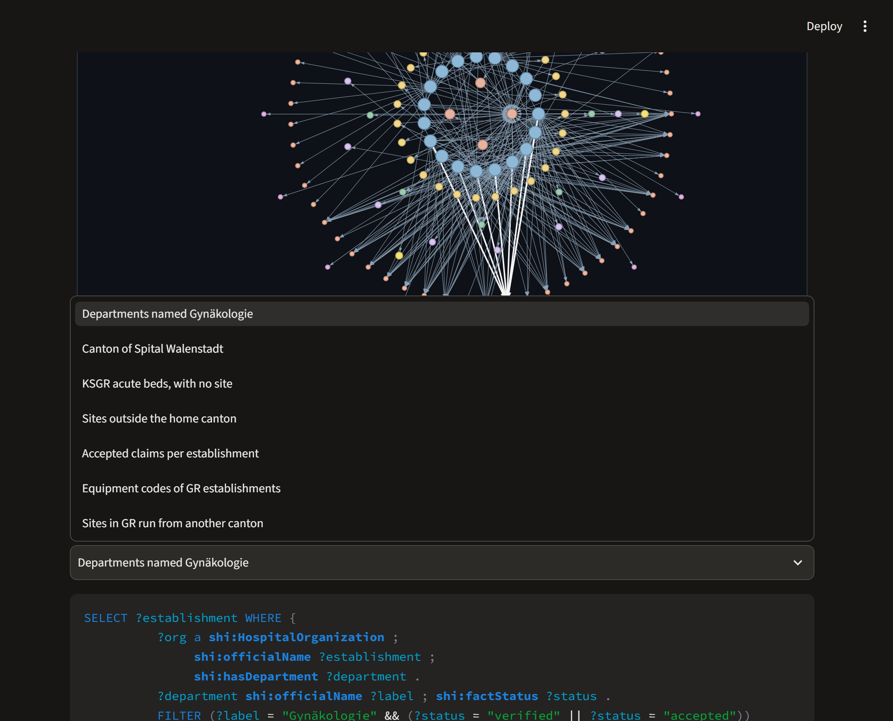
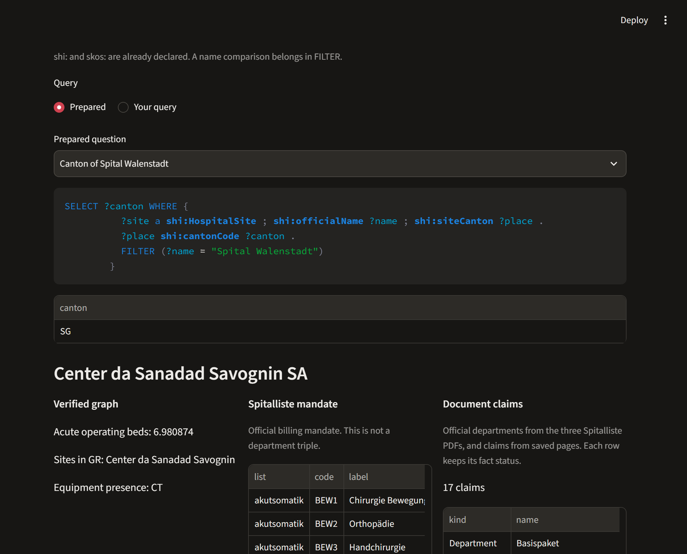
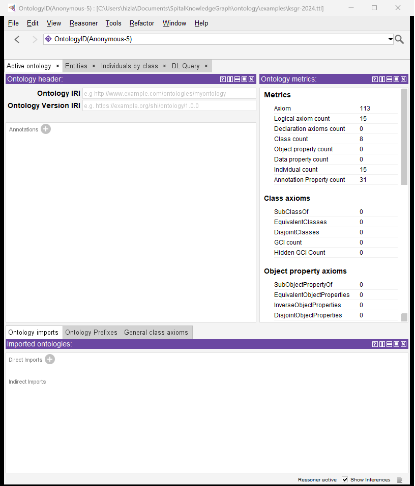
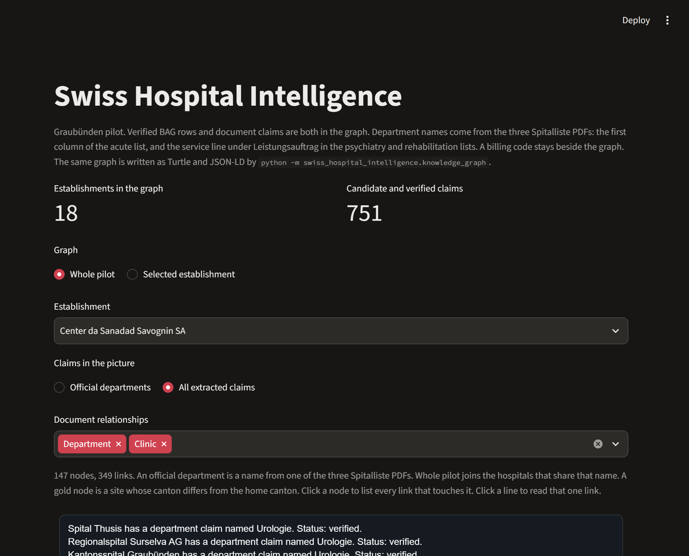
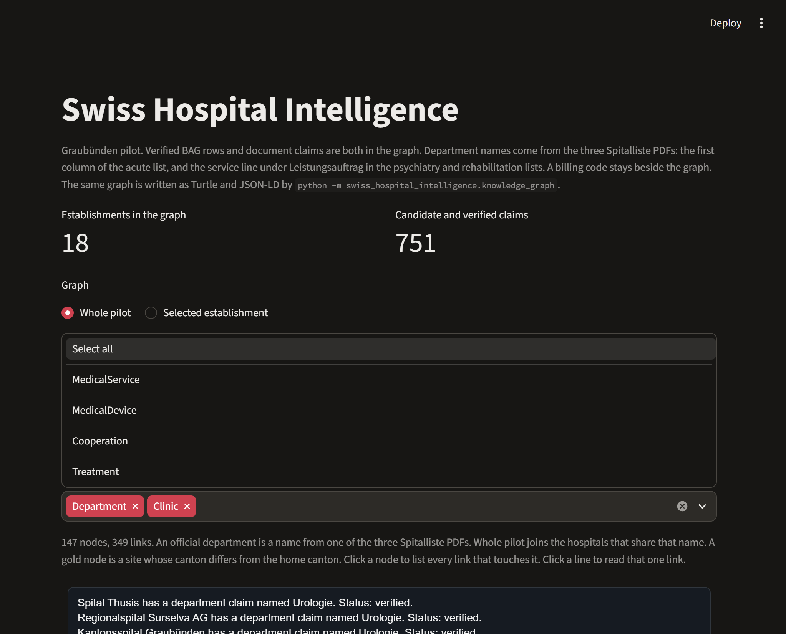
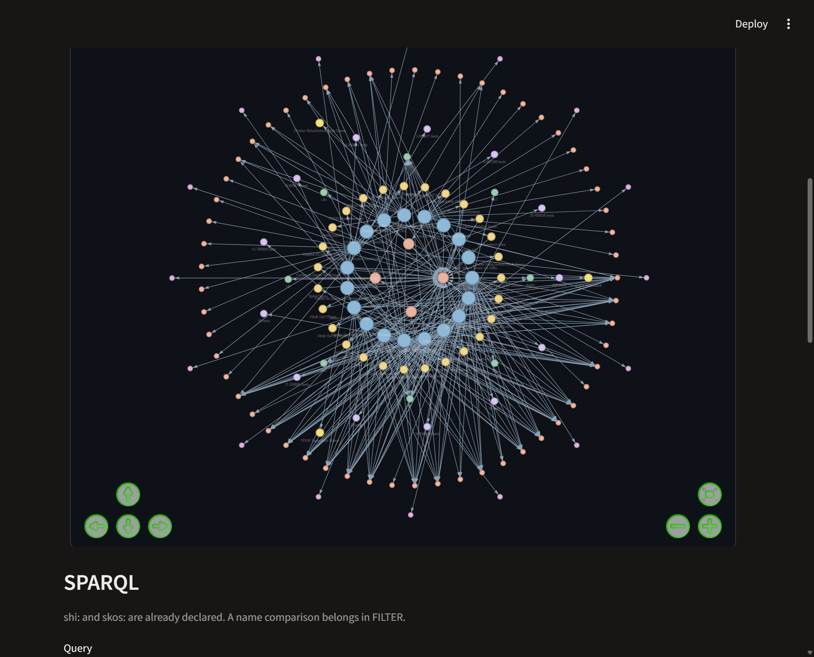

# Swiss Hospital Intelligence

## Pilot Graubünden

Wissensgraph über Schweizer Spitäler. Der Pilot umfasst die 18 Betriebe mit Heimatkanton Graubünden im Kennzahlenjahr 2024.

Die Zahlen stammen aus `data/pilot.sqlite`, Stand 11. November 2026. Der Bildschirm liest diese Datei.

## 1. Frage

Der Graph beantwortet drei Fragen aus amtlichen Quellen.

- Welcher Betrieb hat welchen Standort, und in welchem Kanton liegt er.
- Welche veröffentlichte Zahl gehört zum Betrieb.
- Welche Abteilungsnamen die drei Graubündner Spitallisten drucken.

Eine Zahl bleibt an der Zelle, aus der sie kommt. Ein Abteilungsname bleibt an der Zeile, aus der er kommt.

Beispiel. Das Kantonsspital Graubünden hat 343 Akutbetten (`BettenStatA`). Die Zahl gehört zum Betrieb. Derselbe Betrieb hat den Standort Spital Walenstadt im Kanton St. Gallen. Die Betten werden nicht nach Walenstadt kopiert.

## 2. Aufbau

```text
Excel, drei PDFs, Spitalseiten
        |
        v
PostgreSQL                 Ladeprotokoll
        |
        v
data/pilot.sqlite          Kopie für den Bildschirm
        |
        v
RDF-Graph im Speicher      RDFLib
        |
        v
Streamlit                  http://localhost:8502
```

PostgreSQL ist das System of Record. Der Bildschirm braucht Docker nicht. Er öffnet die SQLite-Kopie und baut den Graphen im Speicher. Es gibt keinen Triple Store und keine Wikidata-Abfrage.

Die Projektion enthält 25 241 Tripel. Davon sind 538 Behauptungen `candidate` und 213 Behauptungen `verified`. Eine Behauptung mit Status `accepted` ist nicht mehr vorhanden. Der Bildschirm zeigt zwei Zahlen: 18 Betriebe und 751 Behauptungen. 751 ist die Summe aus 538 und 213. Standorte, Kantone, Betten und Ausrüstungscodes liegen ausserhalb dieser 751.

## 3. Quellen

### 3.1 BAG-Kennzahlen 2024

Datei `kzp24_data.xlsx`. Katalog: [Kennzahlen der Schweizer Spitäler 2024](https://opendata.swiss/de/dataset/kennzahlen-der-schweizer-spitaler-2024).

Die Datei liefert die Betriebe, die Standorte, die Akutbetten und die Ausrüstungscodes. In der Schweiz sind 270 Betriebe erfasst. 18 haben den Heimatkanton GR.

Das Kantonsspital Graubünden steht mit Typ `K112`, Rechtsform `R2`, Adresse Loëstrasse 170, 7000 Chur. Der Code `MRI` ist eine Ausrüstungspräsenz. Ein Satz auf einer Webseite, der ein Gerät nennt, ist eine eigene Behauptung.

In der BAG-Datei bleiben einzelne Zeichen stehen, wie sie geliefert wurden. Der Standortname `Kantonsspital Graub?nden` wird nicht korrigiert.

### 3.2 Spitalliste Graubünden

Seite des Kantons: [Spitalliste und Spitalplanung](https://www.gr.ch/DE/institutionen/verwaltung/djsg/ga/InstitutionenGesundeitswesens/Spitaeler/Seiten/SpitallisteSpitalplanung.aspx).

| Liste | Stand | Rolle |
|---|---|---|
| [Akutsomatik](https://www.gr.ch/DE/institutionen/verwaltung/djsg/ga/InstitutionenGesundeitswesens/Spitaeler/Dok%20Spitler/Spitalliste_Akutsomatik.pdf) | April 2026 | Erste Spalte unter dem Spitalnamen ist die Abteilung. Der Code daneben ist der Leistungsauftrag. |
| [Psychiatrie](https://www.gr.ch/DE/institutionen/verwaltung/djsg/ga/InstitutionenGesundeitswesens/Spitaeler/Dok%20Spitler/Spitalliste%20Psychiatrie.pdf) | August 2025 | Die Zeile unter Leistungsauftrag ist die Abteilung. |
| [Rehabilitation](https://www.gr.ch/DE/institutionen/verwaltung/djsg/ga/InstitutionenGesundeitswesens/Spitaeler/Dok%20Spitler/Spitalliste_Rehabilitation.pdf) | August 2024 | Dieselbe Regel wie in der Psychiatrie. |

`GYN1` bleibt ein Leistungsauftrag und wird neben dem Graphen gezeigt. Der Name `Gynäkologie` in der ersten Spalte wird `hasDepartment` mit Status `verified`.

Thusis hat 17 Abteilungen, das Kantonsspital Graubünden 24, Savognin 10. Ein umbrochener Name wird zusammengezogen: `Querschnitts-` und `bereiche` ergeben `Querschnittsbereiche`. Eine Fussnote und eine CHOP-Zeile sind keine Abteilungen.

Die Psychiatrischen Dienste Graubünden haben neun Zeilen, darunter Forensische Psychiatrie. Die Überschrift `Kliniken Valens, Rehazentrum Chur…` wird an Kliniken Valens gehängt, weil der Text vor dem Komma dieser Betrieb ist. Das Graubündner Rehazentrum Chur erhält dadurch keine amtliche Abteilungsliste. Seine Seitennamen bleiben `candidate`.

### 3.3 Spitalseiten

Die Seiten der 18 Betriebe wurden mit `urllib.request` gespeichert. HTML und PDF werden in Abschnitte zerlegt. Ein Modell schreibt keine Tripel.

Eine Überschrift oder ein Satz wird nur dann eine Behauptung, wenn ein festes Muster zutrifft. `Klinik`, `Clinica` oder `Reparto` ergibt `hasClinic`. `Dienst` oder `Servizio` ergibt `hasService`. `Zusammenarbeit mit` ergibt `cooperatesWith`. `Behandlung von` ergibt `offersTreatment`. `MRT`, `CT` oder `PET` im Satz ergibt `mentionsEquipment`. Der Status dieser Zeilen ist `candidate`.

## 4. Ontologie

Die Klassen und Eigenschaften stehen in `ontology/swiss_hospital_ontology.ttl`. Das Präfix `shi:` steht für `https://example.org/shi/ontology/`.

| Name | Bedeutung |
|---|---|
| `shi:HospitalOrganization` | Betrieb im Sinn der BAG-Kennzahlen |
| `shi:HospitalSite` | Standort |
| `shi:Canton` | Kanton, identifiziert durch den Zwei-Buchstaben-Code |
| `shi:hasDepartment` | Abteilung des Betriebs |
| `shi:officialName` | Name, wie er veröffentlicht ist |
| `shi:factStatus` | `verified`, `candidate`, `accepted` und weitere Zustände |
| `shi:siteOf` | Standort gehört zu diesem Betrieb |

`hasSite` ist als Umkehrung von `siteOf` deklariert und wird im Piloten nicht materialisiert.

## 5. Vom Tabellenfeld zum Tripel

Der Graph wählt die Zeilen nicht selbst. Die Funktion `project_pilot_graph` liest eine feste Liste.

- Betriebe mit Heimatkanton GR. Zusätzlich ein Betrieb, der einen Standort in GR hat, auch wenn sein Heimatkanton ein anderer ist.
- Standorte dieser Betriebe und Standorte mit Kanton GR.
- Namen mit der Rolle `source_primary`.
- Kennzahlen mit Umfang `establishment`.
- Ausrüstungscodes mit der Menge `equipment`.
- Behauptungen der GR-Betriebe. Das Feld `predicate` bestimmt die Kante.

`service_mandate` wird nicht gelesen. `GYN1` wird kein Knoten. `document_chunk` wird nicht gelesen. Ein Satz wird erst dann ein Knoten, wenn daraus eine Behauptung geschrieben wurde.

Für Gynäkologie am Kantonsspital Graubünden entstehen diese Tripel:

- Der Betrieb `hasDepartment` Gynäkologie.
- Gynäkologie `factStatus` `verified`.
- Gynäkologie `supportedBy` das Zitat `Gynäkologie` aus der ersten Spalte der Akutliste.

## 6. Namen

Ein Betrieb von 2024 wird nur über den exakt normalisierten Namen verknüpft: Unicode-Normalisierung, Kleinschreibung, zusammengezogene Leerzeichen. Rechtsform, Bindestrich und fehlende Wörter bleiben stehen. Eine Beinahe-Übereinstimmung bleibt unverbunden.

Unterengadin ist ein geprüfter Alias. Zürcher RehaZentren Davos gehört nicht zu den 18 GR-Betrieben. Der Standort in Davos gehört zu einem Betrieb mit Heimatkanton ZH und bleibt als Standort in GR im Graphen.

## 7. Zwei Inferenzen

Unterscheidet sich der Standortkanton vom Heimatkanton, schreibt die Projektion eine Behauptung mit Modus `inferred`, Status `verified` und `derivedFrom` einer Prämisse, die die Kantonszelle wiederholt.

| Standort | Betrieb | Heimatkanton | Standortkanton |
|---|---|---|---|
| Spital Walenstadt | Kantonsspital Graubünden | GR | SG |
| PDGR Tagesklinik Glarus | Psychiatrische Dienste Graubünden | GR | GL |
| Z?rcher RehaZentren Klinik Davos | Stiftung Kliniken Valens Davos | ZH | GR |

HermiT läuft nur auf `ontology/examples/ksgr-2024.ttl`. Er materialisiert zwei `hasSite`-Tripel: Das Kantonsspital Graubünden hat den Standort Chur, und es hat Spital Walenstadt. HermiT akzeptiert `xsd:gYear` nicht. Dieser Datentyp wird für den Beispiellauf ignoriert. Der gespeicherte Graph verwendet `xsd:gYear` weiterhin. HermiT fügt keinen Standort und keine Abteilung hinzu.

## 8. SPARQL

Sieben vorbereitete Fragen laufen auf der Projektion. Dieselbe Ansicht nimmt ein handgeschriebenes `SELECT` an. `shi:` und `skos:` sind bereits erklärt. Ein Textvergleich steht in `FILTER`, weil die Projektion `xsd:string` schreibt.



Die Frage nach dem Kanton von Spital Walenstadt:

```sparql
SELECT ?canton WHERE {
  ?site a shi:HospitalSite ;
        shi:officialName ?name ;
        shi:siteCanton ?place .
  ?place shi:cantonCode ?canton .
  FILTER (?name = "Spital Walenstadt")
}
```

`?site` ist ein Standort. Sein Name ist Spital Walenstadt. `shi:siteCanton` führt zum Kantonsknoten. `shi:cantonCode` liest den Code. Das Ergebnis ist SG.



| Frage | Ergebnis |
|---|---|
| Abteilungen mit dem Namen Gynäkologie | Savognin, Engiadina Bassa, Valposchiavo, Flury, Kantonsspital Graubünden, Surselva, Spital Davos, Oberengadin, Thusis |
| Kanton von Spital Walenstadt | SG |
| Akutbetten des KSGR, ohne Standort | 343 |
| Standorte ausserhalb des Heimatkantons | Walenstadt (SG), PDGR Tagesklinik Glarus, Zürcher RehaZentren Klinik Davos |
| Akzeptierte Behauptungen je Betrieb | Keine Zeile |
| Ausrüstungscodes | Vorhanden, wo der Betrieb sie veröffentlicht. Das KSGR hat Angio, CC, CT, Dia, LB, Lito, MRI und PET |
| Standorte in GR mit Heimatkanton ausserhalb | Zürcher RehaZentren Klinik Davos, Heimatkanton ZH |

Die Variablen `?site`, `?name` und `?canton` wählt die Abfrage. Die Namen `shi:HospitalSite`, `shi:officialName`, `shi:siteCanton` und `shi:cantonCode` stehen in der Ontologie. Die Projektion schreibt genau diese Eigenschaften.

## 9. SHACL

`ontology/shapes/core.shacl.ttl` wird mit pySHACL ausgeführt. Das KSGR-Beispiel ist konform. Derselbe Befehl schreibt den Piloten und prüft ihn:

```text
python -m swiss_hospital_intelligence.knowledge_graph
```

Der Befehl liest PostgreSQL. Er schreibt `data/exports/graubunden-pilot.ttl`, die JSON-LD-Datei, den SHACL-Bericht und das HermiT-Ergebnis des KSGR-Beispiels. Diese Dateien werden nicht ins Repository gelegt. Protégé öffnet die Ontologie und das KSGR-Beispiel aus `ontology/`.



## 10. Bildschirm

`run.bat` richtet die Umgebung ein und öffnet http://localhost:8502.

Beim Start sind **Whole pilot** und **All extracted claims** gewählt. Die Beziehungsliste bietet Department, Clinic, MedicalService, MedicalDevice, Cooperation und Treatment. Event und Assertion bleiben in der Datenbank und erscheinen nicht in der Liste.





Ein blauer Punkt ist der Betrieb, ein blassgelber der Standort, ein pfirsichfarbener der Kanton, ein grüner der Ausrüstungscode, ein lila die Bettenzahl, ein lachsfarbener die Abteilung, ein violetter die Klinik. Ein goldener Punkt ist ein Standort, dessen Kanton vom Heimatkanton abweicht.

Unter dem Bild stehen die vorbereiteten SPARQL-Fragen und ein freies `SELECT`. Darunter stehen für den gewählten Betrieb die Betten, die Standorte, die Ausrüstung und die Leistungsaufträge. Ein Leistungsauftrag ist kein Abteilungstripel.



## 11. Bewusst weggelassen

- Ein Abrechnungscode wird keine Abteilung. Die Abteilung ist die erste Spalte der Akutliste oder die Zeile unter Leistungsauftrag in Psychiatrie und Rehabilitation.
- Ein Wort in der URL wird kein Standort.
- Betten werden nicht auf den Standort kopiert.
- Beinahe gleiche Namen werden nicht zusammengeführt.
- Das Fragezeichen in den BAG-Namen wird nicht ersetzt.
- Ein Sprachmodell schreibt keine Behauptungen. Das Feld `model_name` bleibt leer.
- Ein Assistent und FastAPI sind nicht gebaut.

Einige gespeicherte Dateien lieferten keinen Text: eine PowerPoint-Datei, Seiten mit Status 404, ein gescanntes PDF und eine Datei über 20 MB. Aus diesen Dateien entsteht keine Behauptung. Der Graph, die Abteilungen und die Frage nach Spital Walenstadt hängen nicht an diesen Dateien. Der Bildschirm listet sie nicht.

## 12. Schluss

Der Pilot zeigt für 18 Graubündner Betriebe, welche amtliche Zelle eine Zahl trägt und welche amtliche Zeile einen Abteilungsnamen trägt. Seitenaussagen bleiben `candidate` und tragen ihre Fundstelle. Die SPARQL-Frage nach Spital Walenstadt liest den gespeicherten Kanton SG. Sie fragt Wikidata nicht.
